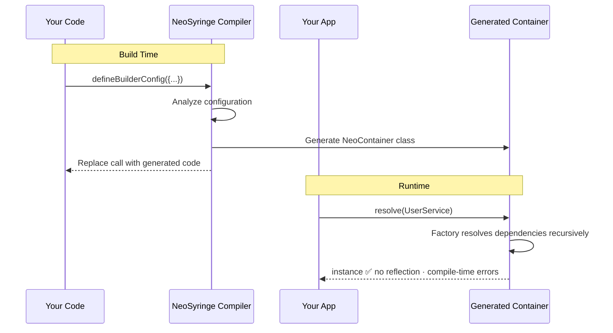

# What is NeoSyringe?

NeoSyringe is a **next-generation dependency injection system** for TypeScript that shifts resolution from **runtime** to **build-time**.

## The Problem with Resolving at Runtime

When wiring is resolved while the program runs, a wrong or missing binding is found when `resolve()` is called. A runtime approach often looks like this (an illustration, not a description of one library):

```typescript
// Runtime approach, with decorators
@injectable()
class UserService {
  constructor(@inject(TYPES.ILogger) private logger: ILogger) {}
}

// At runtime
container.resolve(UserService); // ← Resolution happens HERE
```

NeoSyringe moves that work to the build. This page makes no claim about how other libraries work. The [alternatives page](./alternatives.md) lists only what their own documentation says, with the access date.

| Concern | What NeoSyringe does |
|---------|----------------------|
| **Missing bindings** | Reported at build time, by the IDE plugin and the CLI (`NEO_MISSING_PROVIDER`) |
| **Classes** | Stay plain: no decorators and no `reflect-metadata` |
| **Interfaces** | `useInterface<T>()` gives a token; the build derives its id |
| **Generated container** | Created at build time. Its size depends on the features you use: see [Profiles](./profiles.md) |

## The NeoSyringe Solution

NeoSyringe works as a **compiler plugin** that analyzes your configuration and generates optimized code:

```typescript
// Your code (pure TypeScript!)
interface ILogger {
  log(msg: string): void;
}

class UserService {
  constructor(private logger: ILogger) {}
}

// Configuration
export const container = defineBuilderConfig({
  injections: [
    { token: useInterface<ILogger>(), provider: ConsoleLogger },
    { token: UserService }
  ]
});
```

At build time, the build plugin replaces the `defineBuilderConfig(...)` call with a generated container class, in the same file.

## Key Advantages

### 🚀 Generated Containers

The container is code your build emits for your graph. Its size depends on the graph and on the [profile](./profiles.md); no size or speed figure is promised. The one published measurement is in the [profiles guide](./profiles.md#what-the-numbers-say-and-what-they-do-not).

### ✨ Native Interface Support

Use `useInterface<ILogger>()` instead of managing Symbols. The compiler generates unique IDs automatically.

### 🛡️ Compile-Time Safety

Errors are detected in your IDE before you even save the file:

- Circular dependencies
- Missing bindings
- Duplicate registrations
- Type mismatches

### 📦 Pure Classes

Your business classes have **no DI imports**:

```typescript
// ✅ Pure TypeScript class
class UserService {
  constructor(private logger: ILogger) {}
}

// ❌ Traditional approach (polluted)
@injectable()
class UserService {
  constructor(@inject(TYPES.ILogger) private logger: ILogger) {}
}
```

### 🔄 Gradual Migration

Bridge existing containers while migrating:

```typescript
export const container = defineBuilderConfig({
  useContainer: legacyTsyringeContainer, // ← Delegate to legacy
  injections: [
    { token: NewService } // New services in NeoSyringe
  ]
});
```

## How It Works



## Next Steps

- [Getting Started](/guide/getting-started) - Install and configure NeoSyringe
- [Basic Usage](/guide/basic-usage) - Learn the core concepts
- [Why NeoSyringe?](/guide/why-neo-syringe) - Detailed comparison with alternatives

